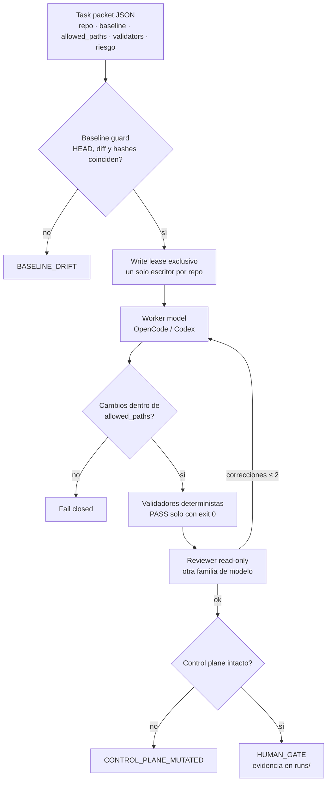

# VilTech AgentFlow V0

> A fail-closed local coordinator for AI coding agents: a worker model edits a repo inside a write lease and declared paths, deterministic validators check it, an independent model from another family reviews it read-only, and every run stops at a human gate — never commit, push or deploy.

**Estado:** Experimental (funcional en Linux, desarrollo pausado)

## Qué problema resuelve

Delegar código a agentes de IA (OpenCode, Codex) ahorra tiempo, pero el riesgo es real: tocan archivos que no deben, "arreglan" tests en vez de código, se cuelgan o modifican al propio orquestador. AgentFlow envuelve cada delegación en un contrato verificable. Lo que el agente cambió, cómo se validó y quién lo revisó queda como evidencia en disco, y la decisión final siempre la toma una persona.

## Cómo funciona



Decisiones de diseño clave:

- **Fail-closed por defecto.** Cada anomalía (baseline cambiado, archivo fuera de alcance, salida de modelo inválida, validador sin exit 0) termina con un código explícito. Nunca se "sigue igual".
- **El agente no puede reescribir a su juez.** Antes y después de cada llamada a un modelo se verifica un manifiesto del *control plane* (código del orquestador, prompts, permisos, config). Si cambia, la corrida se detiene, y un *poison ledger* durable impide que una corrida futura acepte ese estado como confiable.
- **Revisión independiente obligatoria en tareas HIGH/CRITICAL.** El revisor usa otra familia de modelos y un perfil sin permisos de escritura ni shell.
- **El agente nunca hace commit, push, PR, merge ni deploy.** Esos comandos están prohibidos en los prompts y en los permisos; la salida exitosa es solo `HUMAN_GATE`.
- **Solo biblioteca estándar de Python** y escritura atómica con `fsync` para toda la evidencia (`runs/<run>/final.json`), que así puede auditarse después de un crash.

## Qué funciona hoy

Requisitos: **Linux** (usa `fcntl`, `/proc` y señales POSIX), Python 3 (probado con 3.12), `git` y al menos una de las CLIs `opencode` o `codex`, ya autenticada.

```bash
python3 agentflow.py inspect      # entorno, CLIs detectadas, comandos que exigen human gate
python3 agentflow.py models       # perfiles de modelo y roles (config/models.json)
python3 -m unittest discover -s tests   # 1132 tests
python3 agentflow.py run <task.json>
python3 agentflow.py program run programs/example.json
python3 agentflow.py queue run <queue.json>
```

- **Tests:** 1132 pasan en Linux (Ubuntu 24.04 / WSL, Python 3.12). Incluyen pruebas de *mutation testing* sobre los runners de producción.
- `inspect` y `models` están verificados.
- Modos disponibles: tarea individual, *programas* (arquitecto → hasta 4 subtareas secuenciales → revisión integrada), *colas* secuenciales de hasta 8 programas con presupuestos de tiempo y llamadas a modelos, y *Finding Pipeline Runner* (un hallazgo → candidato revisado → human gate).
- Se usó en desarrollo real para coordinar trabajo en un proyecto de cliente. Los task packets de ese trabajo no se publican; en `tasks/` quedan 3 ejemplos genericizados sobre el propio AgentFlow.
- La documentación técnica completa (invariantes, watchdog, programas, colas, evidencia) está en [`docs/MANUAL.md`](docs/MANUAL.md).

## Qué no funciona / quedó pendiente

- **En uso real terminó bien ~1 de cada 3 veces.** En 29 corridas reales (16–18 sep 2026), 9 llegaron a `HUMAN_GATE`, 17 se detuvieron y 3 quedaron sin `final.json`. La causa más frecuente fue **el propio write lease** (7 paradas por `WRITE_LEASE_CONFLICT` u `OWNERSHIP_LOST`, por leases viejos que se bloqueaban solos). Le siguieron baseline drift, validadores fallidos o inseguros y salidas de modelo inválidas (2 cada uno). Algunas paradas fueron pruebas intencionales del bootstrap.
- Después de esas corridas invertí ~5 días en endurecer el lease y el control plane (casi todos los 1132 tests son de esa etapa), **sin volver a usarlo en tareas reales**. El diseño fail-closed es correcto, pero en la práctica la seguridad estorbó más de lo que ayudó.
- **Solo Linux.** En Windows nativo la mayoría de los tests fallan por `fcntl`/`SIGKILL`.
- **Los comandos `run`/`program`/`queue` invocan modelos reales** y consumen cuota. Requieren un repo objetivo con ruta absoluta; los task packets de ejemplo apuntan a `~/repos/...` y hay que adaptarlos. `tasks/example.json`, que mencionaba la documentación original, no existe.
- `config/models.json` refleja mis CLIs y modelos a la fecha (sep-2026). En otra máquina hay que redescubrir los IDs exactos.
- **Este snapshot no incluye dos líneas de trabajo que no llegué a mergear**: correcciones de integridad del candidato y una campaña de mutation testing de auditoría.
- No hay paralelismo, DAG ni router adaptativo, ni interfaz web: es una herramienta de línea de comandos, secuencial a propósito.
- La complejidad creció rápido (~17k líneas en el orquestador y sus herramientas). El siguiente paso razonable era simplificar, no agregar.

## Qué aprendí

- La seguridad de un orquestador de agentes no está en el prompt sino en **invariantes verificables por fuera del modelo**: alcance de archivos, manifiestos del control plane y validadores con exit code.
- Un agente que puede modificar su propio entorno de evaluación es el caso más peligroso, y detectarlo requiere evidencia durable entre corridas, no solo dentro de una.
- Usar modelos de otra familia como revisores encontró errores que el mismo modelo no veía en su propio trabajo.
- Diseñar "fail-closed + human gate" desde el inicio hizo posible delegar trabajo real sin miedo a perder control del repo.
- También aprendí el costo: cada garantía extra suma código y tests. Saber cuándo congelar un diseño es parte del trabajo.

## Stack

Python 3 (solo stdlib) · Git worktrees · OpenCode · Codex CLI · JSON Schema · `unittest` · Linux (`fcntl`, `/proc`, process groups)

## Licencia

© 2026 Jhon Villegas — [AGPL-3.0](LICENSE). Para uso comercial bajo otros términos, contáctame.
